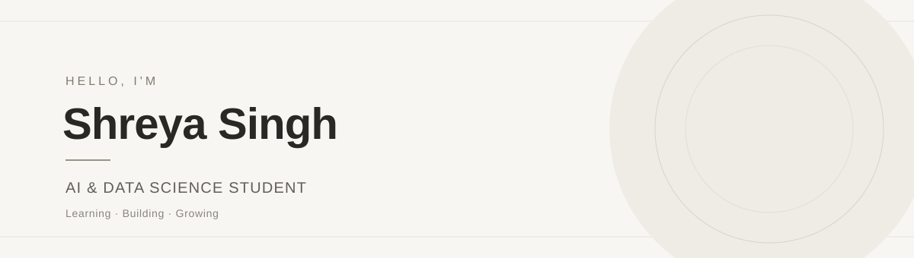

<!-- Minimal developer portfolio -->

 

**AI & DATA SCIENCE STUDENT**

Learning, building, and exploring through practical projects.

[GitHub](https://github.com/ShreyaSingh46) · [Repositories](https://github.com/ShreyaSingh46?tab=repositories)

---

## About

- Third-year B.Tech student in **Artificial Intelligence & Data Science**.
- Interested in **Machine Learning, Data Science, and Web Development**.
- I enjoy learning by building projects and turning ideas into working applications.
- Open to internships, collaboration, and opportunities to learn.

## Skills

**Languages:** Python, JavaScript, HTML, CSS

**Frameworks & Tools:** React, Tailwind CSS, MySQL, Figma

## Selected Projects

| Project | Description |
| --- | --- |
| [ChurnGuard](https://github.com/ShreyaSingh46/ChurnGuard-Customer-Churn-Prediction) | Customer churn prediction using machine learning. |
| [Autonomous Robot Navigation](https://github.com/ShreyaSingh46/Autonomous-Robot-Navigation-System) | Grid-based pathfinding with A*, BFS, DFS, and UCS. |
| [Automated Travel Planner](https://github.com/ShreyaSingh46/Automated-Travel-Planner) | Travel planning using classical AI search and optimization algorithms. |
| [Quest Solver Lab](https://github.com/ShreyaSingh46/quest-solver-lab) | React interface connected to Python puzzle solvers. |
| [Smart Medical Diagnosis](https://github.com/ShreyaSingh46/Smart-Medical-Diagnosis-System) | Educational project exploring Bayesian reasoning. |
| [DYPCOE College Website](https://github.com/ShreyaSingh46/DYPCOE-College-Website) | College website built with HTML, CSS, and JavaScript. |

## GitHub

---

Thanks for stopping by.

